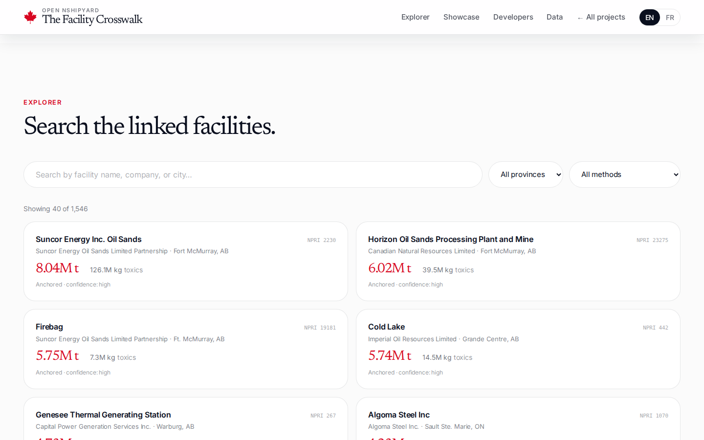
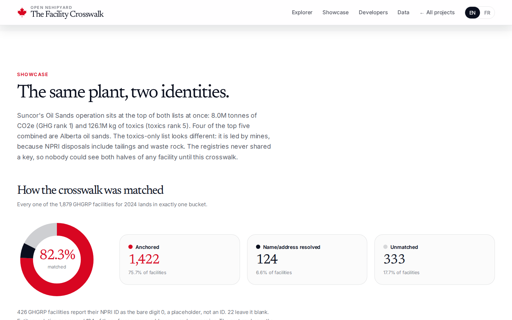

# canada-facility-crosswalk

**The Facility Crosswalk: which carbon emitters are also the worst toxic polluters.** Open Nshipyard project P2.

Environment and Climate Change Canada runs two facility registries that share no published key. The Greenhouse Gas Reporting Program (GHGRP) names 1,879 emitters for 2024. The National Pollutant Release Inventory (NPRI) tracks 24,553 polluters since 1993. This project links them for the 2024 reporting year: 1,422 anchor matches on self-reported NPRI IDs, entity resolution for the rest, quarantine for the ambiguous.

An open-source civic project. Not affiliated with the Government of Canada or Environment and Climate Change Canada.

Proposed domain: `crosswalk.canada.nshipyard.com`.

## Screenshots

Screenshots live in `docs/screenshots/` (captured during the verification loop):





## What the data shows

- 1,546 of 1,879 GHGRP facilities linked to the NPRI (82.3%): 1,422 anchored on self-reported NPRI IDs (75.7%), 124 recovered by name/address/company resolution, 333 honestly unmatched, 144 quarantined.
- **Suncor Energy Inc. Oil Sands** sits at the top of both lists at once: 8.0M tonnes CO2e (GHG rank 1) and 126.1M kg of toxics (rank 5). Four of the top five combined are Alberta oil sands.
- The toxics-only list is led by mines: **Copper Mountain Mine** reported 258.3M kg in 2024 against 43,028 t CO2e. The driver is disposals (tailings, waste rock), not air releases.
- 426 GHGRP facilities (22.7%) report their NPRI ID as the bare digit 0, a placeholder, not an ID. 22 leave it blank.
- Only 3 quantity-file NPRI IDs were absent from the geolocations master. None resolved unambiguously. The temp-ID problem is smaller than the registry documentation implies.

## Files

- `public/data/crosswalk.csv` - the join table: 1,546 rows with NPRI ID, GHGRP ID, match method, confidence, temp-ID aliases
- `public/data/facilities.json` - full combined records: GHG tonnes CO2e beside toxic releases/disposals in kg
- `public/data/ranking_combined.json` - top 25 by rank-sum of GHG rank and toxics rank
- `public/data/ranking_ghg.json`, `public/data/ranking_toxics.json` - top 25 single-axis rankings
- `public/data/stats.json` - match statistics and totals
- `public/data/provinces.json` - per-province aggregates
- `public/data/quarantine.json` - quarantined ambiguous matches, logged for audit
- `public/data/temp_id_aliases.json` - temp NPRI IDs resolved to permanent IDs
- `scripts/build_crosswalk.py` - the full reproducible pipeline

## Methodology

Sources (retrieved 2026-10-10, Open Government Licence - Canada): NPRI bulk files for all years (ECCC dataset `40e01423-7728-429c-ac9d-2954385ccdfb`, updated 2026-05-01) and the GHGRP emissions-by-gas file `PDGES-GHGRP-GHGEmissionsGES-2004-Present` (ECCC dataset `a8ba14b7-7f23-462a-bdbb-83b0ef629823`, updated 2026-05-27). Anchor matching on the self-reported Facility NPRI ID. Entity resolution (uppercase, strip accents, drop legal suffixes, same-province scoring at 0.90+, 25 km spatial check) for the 457 unanchored. Quarantine for the ambiguous. Toxic totals are 2024 releases plus disposals in kilograms, units normalized. Grams of toxic equivalent excluded. Transfers for recycling are excluded pending a complete retrieval of the transfers bulk file. 2024 vintage on both sides. GHGRP covers facilities at 10 kt CO2e/yr or more. Kilograms are not harm.

Full detail: `src/i18n.tsx` methodology section (EN+FR), `docs/datafix-entry.md`.

## Develop

```bash
npm install
npm run dev
```

## API

REST under `/api/v1/`:

- `GET /api/v1/facility/search?q=syncrude&province=AB&method=anchored&limit=50` - search matched facilities
- `GET /api/v1/facility/lookup?npri_id=107` (or `?ghgrp_id=G10023`) - full combined record
- `GET /api/v1/facility/points` - lightweight coordinate set for the map
- `GET /api/v1/crosswalk/summary` - match stats, rankings, province aggregates

OpenAPI 3.1 spec at `/api/openapi.json`.

MCP (streamable HTTP, JSON-RPC 2.0): `POST /mcp` with tools `facility_lookup`, `crosswalk_search`, `match_stats`.

## Author

**Richardson Dackam** - [X (@richardsondx)](https://x.com/richardsondx) · [GitHub](https://github.com/richardsondx)

## License

MIT. Source data is © Environment and Climate Change Canada (Open Government Licence - Canada). The crosswalk and derived tables are original work.
